# คนละนิด login and admin polish — visual evidence

Before: base commit `2da699a` — plain form, horizontal navigation, and uniform stacked cards.
After: an illustrated login, responsive team navigation, glanceable counts, a reading/work split in the inbox, and calmer team and audit cards. All Thai copy, roles, handlers and data flow are preserved. No dependencies were added.

## Capture method

Screenshots render the actual exported React pages and KlShell with the app stylesheet and existing Mali/Noto Sans Thai font links. The before images use the base commit sources; after images use this branch. Both use identical fictional contact, team and audit fixtures in a separate local Vite harness. Login is logged out; admin is rendered in its ready/owner presentation state. No production session, personal data, payment or API write was used. The harness and its service stubs are outside the repository and are not shipped.

Viewport sizes: 390 × 844 and 1440 × 1000; full-page PNG captures (scrollbar space may reduce captured content width). Browser checks found no horizontal overflow, no text below 13px, and no controls below 44px in these views. Body text is 15–16px. Existing token text/background pairs retain at least 4.5:1 contrast, statuses include text, focus outlines are visible, and reduced-motion is respected. The mobile OTP step and team-removal confirmation were also visually checked using fixtures.

Validation: `npx vitest run` — 109/109; `npx tsc --noEmit -p .` — passed; `npx vite build` — passed. A TypeScript AST comparison confirmed Thai literals/JSX text and existing roles/ARIA labels unchanged in all six route files. Independent review inspected all ten after screenshots and the diff.

## `/login`

| Width | Before | After |
| --- | --- | --- |
| 390px | 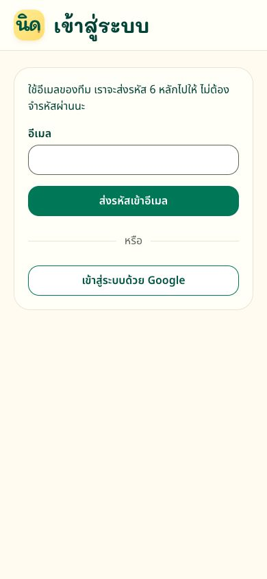 | 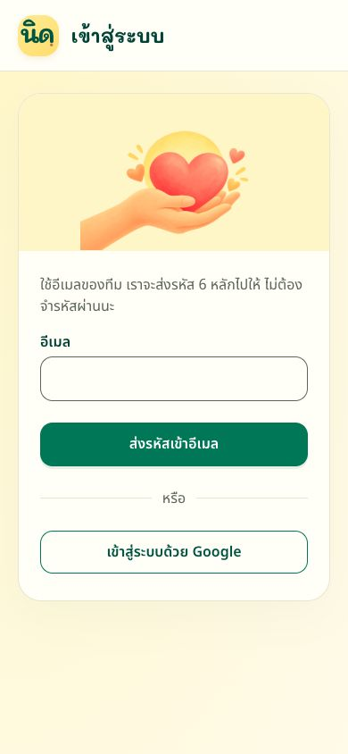 |
| 1440px | 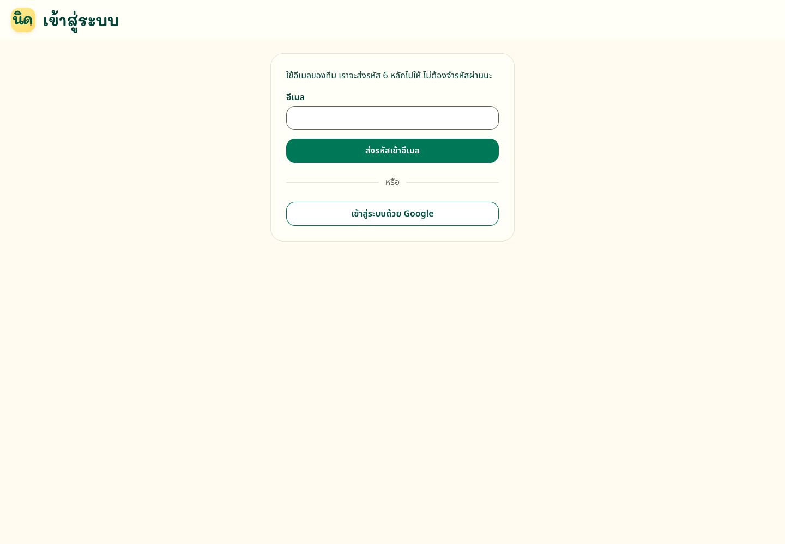 | 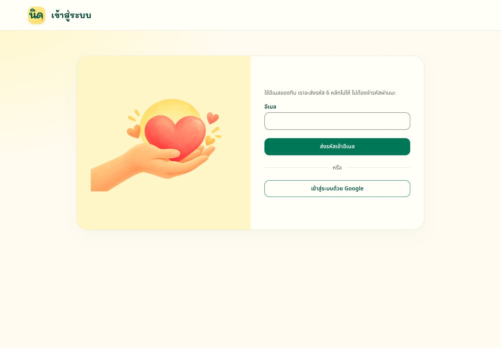 |

## `/admin`

| Width | Before | After |
| --- | --- | --- |
| 390px | 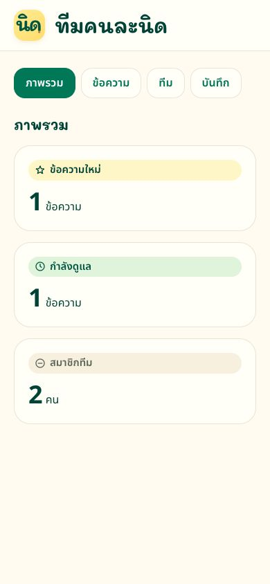 | 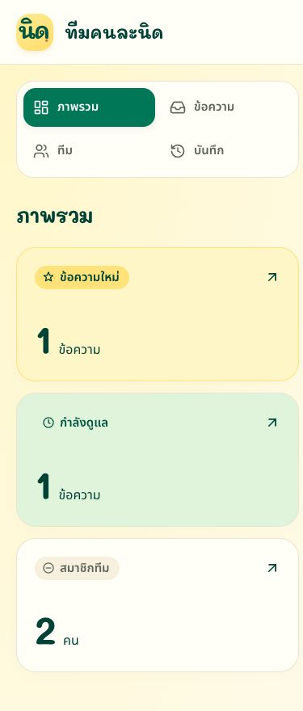 |
| 1440px | 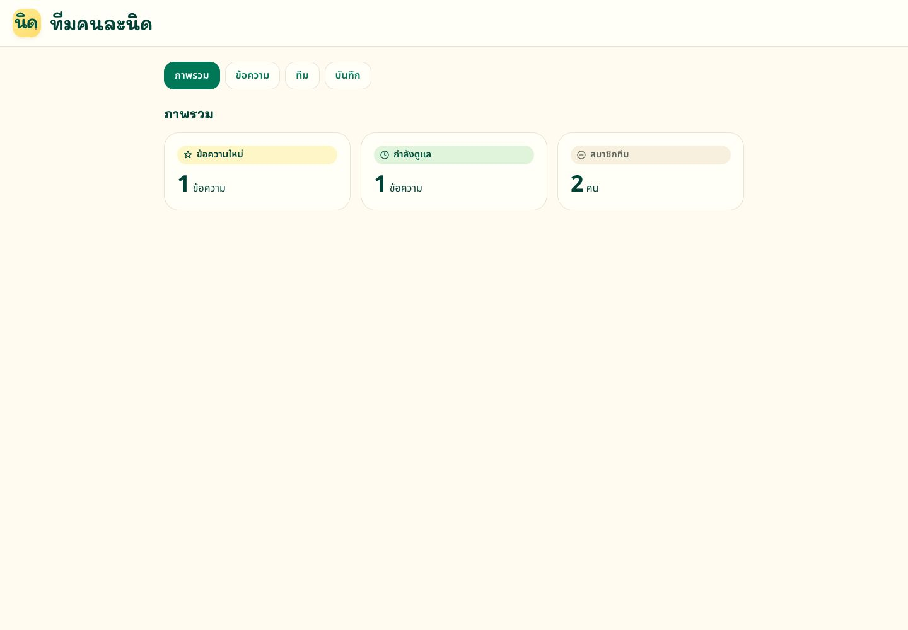 | 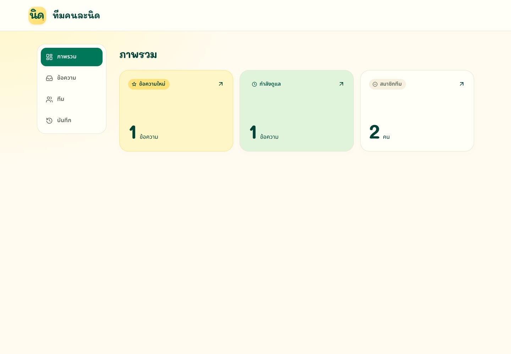 |

## `/admin/messages`

| Width | Before | After |
| --- | --- | --- |
| 390px | 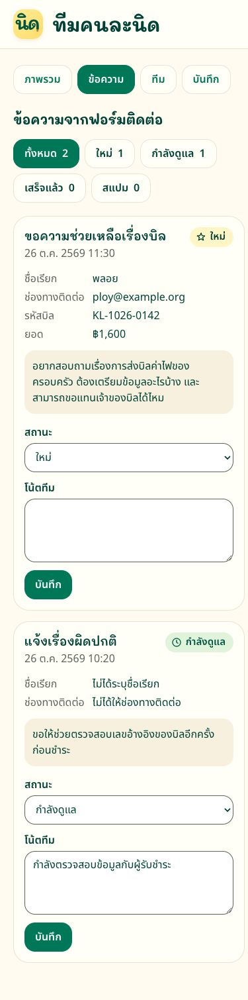 | 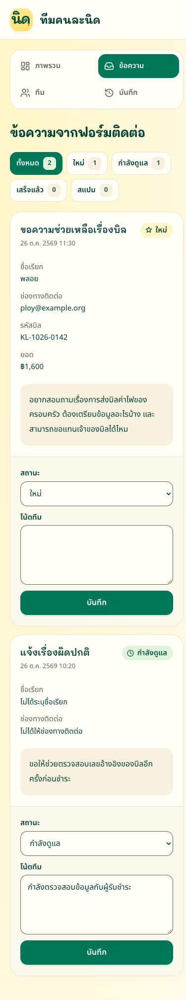 |
| 1440px | 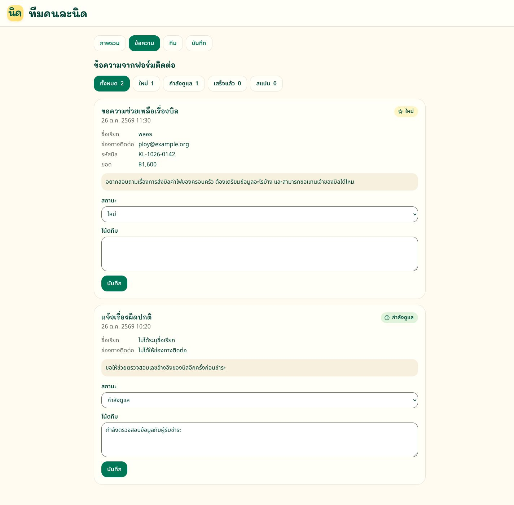 | 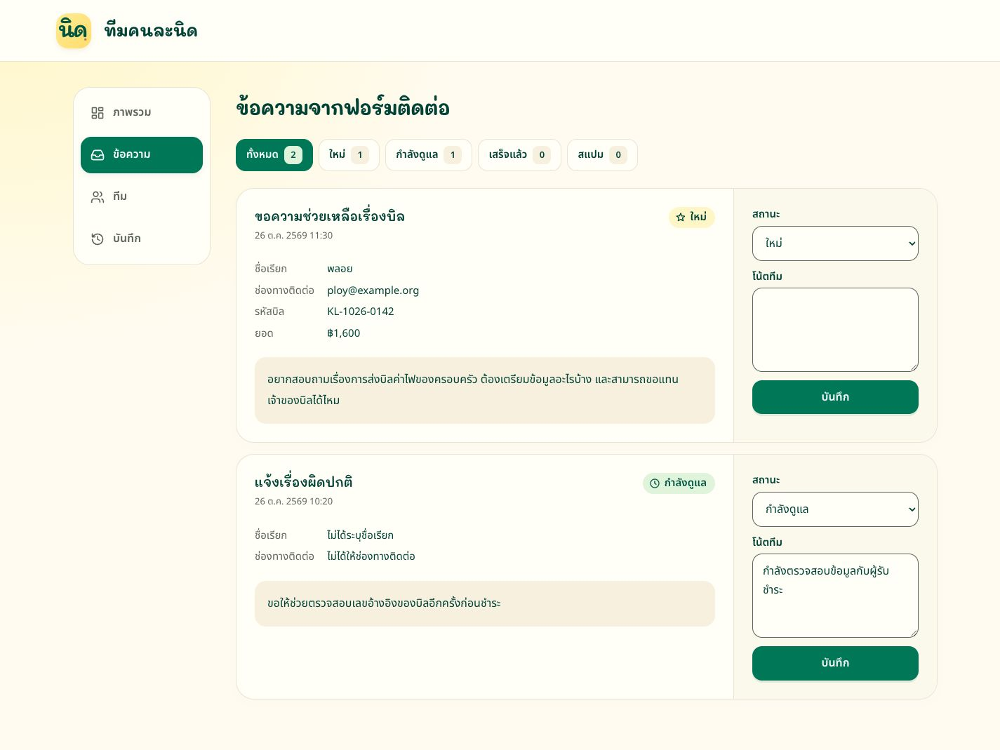 |

## `/admin/team`

| Width | Before | After |
| --- | --- | --- |
| 390px | 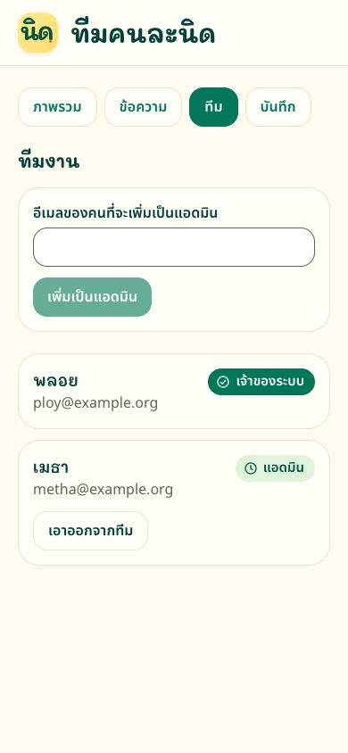 | 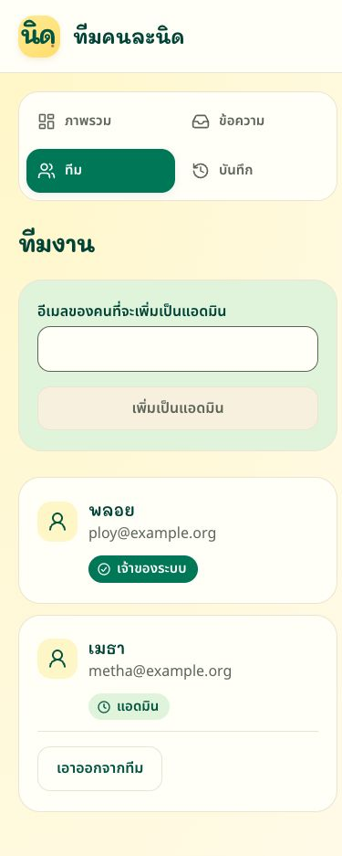 |
| 1440px | 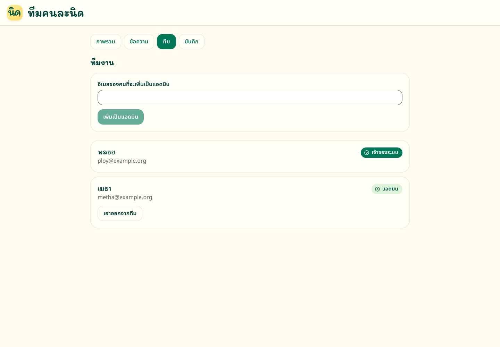 | 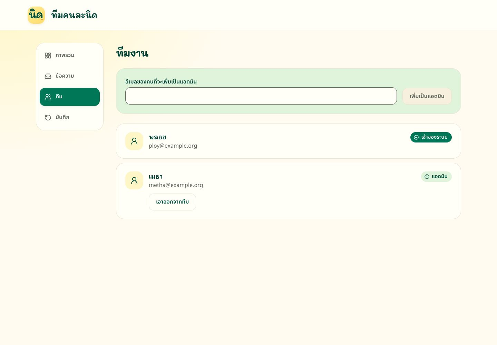 |

## `/admin/log`

| Width | Before | After |
| --- | --- | --- |
| 390px | 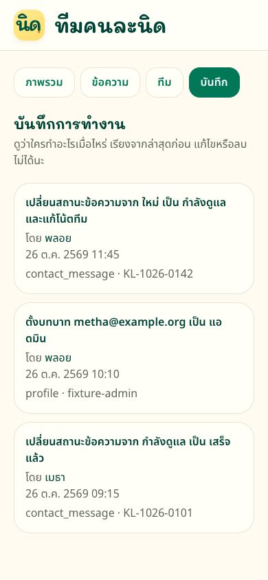 | 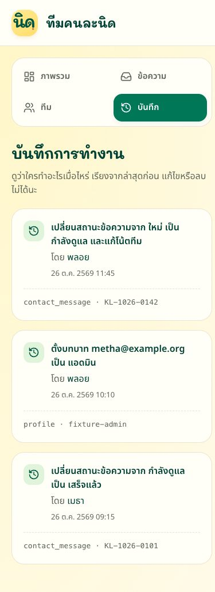 |
| 1440px | 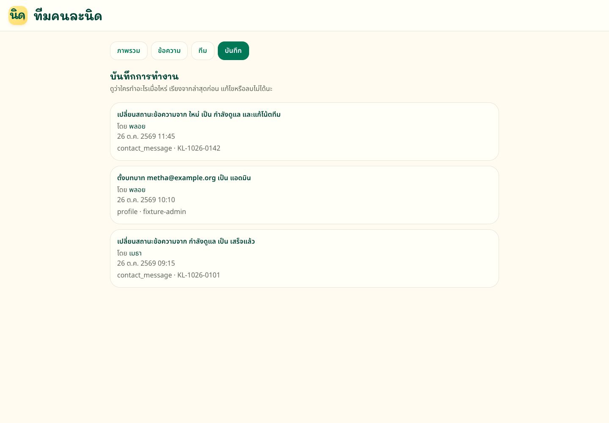 | 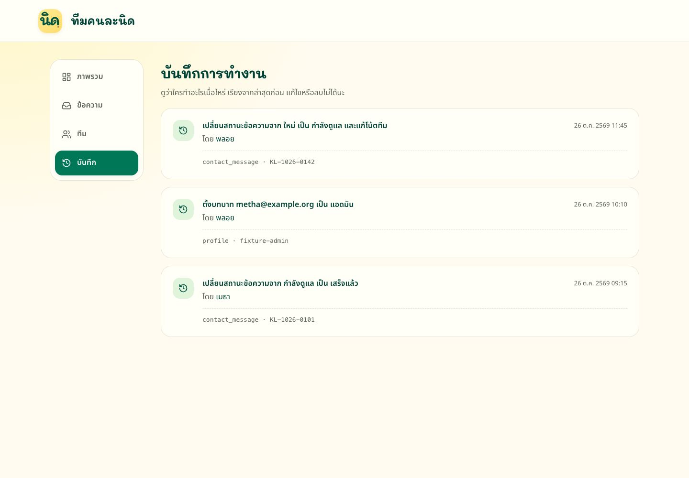 |
